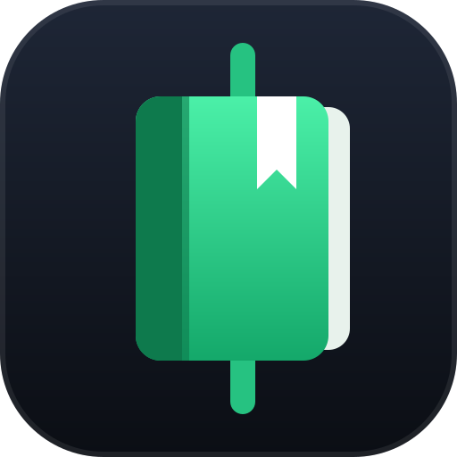

<p align="center"></p>

<h1 align="center">EdgeBook</h1>

Trader'ların işlemlerini kaydedip performanslarını analiz ettiği, yapay zeka destekli masaüstü trading journal uygulaması.

> Fırat Üniversitesi Nesne Tabanlı Programlama dersi dönem projesi olarak geliştirilmiştir. Ticari bir ürün değildir.

### ⬇️ [EdgeBook'u indir (Windows, kurulum dosyası)](https://github.com/YasirCelikStack/edgebook/releases/latest/download/EdgeBookApp-win-Setup.exe)

İndirdiğiniz `EdgeBookApp-win-Setup.exe` dosyasını çalıştırmanız yeterli. Uygulama kendini otomatik günceller. Ayrıntılar aşağıdaki [İndir](#i̇ndir) bölümünde.

> [!IMPORTANT]
> **"Windows bilgisayarınızı korudu" uyarısı çıkarsa:** Pencerede **Ek bilgi**'ye, ardından **Yine de çalıştır**'a tıklayın.
>
> Bu uyarı EdgeBook'ta bir sorun olduğu anlamına gelmez. Windows SmartScreen, ücretli bir kod imzalama sertifikasıyla imzalanmamış ve henüz az kişinin indirdiği programlarda bu uyarıyı gösterir. EdgeBook bir öğrenci projesidir ve imzasızdır. Kaynak kodun tamamı bu repoda açıktır; kurulum dosyası bu repodaki koddan GitHub Actions ile ([release.yml](.github/workflows/release.yml)) üretilip [Releases](https://github.com/YasirCelikStack/edgebook/releases) sayfasına yüklenir. Dosyayı yalnızca bu sayfadan indirin.

## İndir

**[Kurulum dosyasını indir](https://github.com/YasirCelikStack/edgebook/releases/latest/download/EdgeBookApp-win-Setup.exe)** (her zaman en son sürüm) ya da **[Releases](https://github.com/YasirCelikStack/edgebook/releases/latest)** sayfasından `EdgeBookApp-win-Setup.exe` dosyasını indirip çalıştırın. .NET kurmanıza gerek yoktur.

- Kurulumdan sonra EdgeBook, Başlat menüsünden açılır.
- **Güncellemeler otomatiktir:** Yeni sürüm yayınlanınca uygulama açılışta üstte bir şerit gösterir; "Şimdi güncelle"ye basınca yeni sürüm indirilir ve uygulama yeniden başlar. Sol alttaki sürüm yazısına tıklayarak da güncellemeleri denetleyebilirsiniz.
- Verileriniz (`%LocalAppData%\EdgeBook`) güncellemelerden ve kaldırmadan etkilenmez.
- İmzasız bir uygulama olduğu için Windows ilk kurulumda "Windows bilgisayarınızı korudu" uyarısı gösterebilir: **Ek bilgi → Yine de çalıştır** (açıklaması sayfanın başında).
- Yapay zeka koçu için ücretsiz bir Gemini anahtarı gerekir; uygulama içindeki **Yapay zeka koçu → Anahtar ayarla** penceresi adım adım anlatır.

## Teknolojiler

- C# / .NET 10, Windows Forms
- DevExpress WinForms bileşenleri
- SQLite + Entity Framework Core 10
- Google Gemini API (yapay zeka koçu)
- Supabase REST API (Chart Vault entegrasyonu)

## Proje yapısı

| Katman | Sorumluluk |
|---|---|
| `TradingJournal.Core` | Entity'ler (`Trade`, `ForexTrade`, `CryptoTrade`, `Account`...), arayüzler, doğrulama |
| `TradingJournal.Data` | EF Core `DbContext`, tablo eşlemeleri, generic repository, migration'lar |
| `TradingJournal.Services` | İş mantığı: istatistikler, analiz, risk kuralları, yapay zeka koçu, Chart Vault aktarımı, ekran görüntüleri, örnek veri |
| `TradingJournal.UI` | DevExpress ile Windows Forms arayüzü |

Bağımlılık yönü tek taraflıdır: **UI → Services → Data → Core**.

## Veritabanı

Tablolar: `Accounts`, `AccountRules`, `Instruments`, `Strategies`, `Tags`, `Trades`, `TradeTags` (çoka-çok ara tablo), `TradeScreenshots`.

`ForexTrade` ve `CryptoTrade`, `Trades` tablosunda `TradeType` sütunuyla ayrılır (Table-Per-Hierarchy).

Veritabanı dosyası `%LocalAppData%\EdgeBook\edgebook.db` konumunda oluşturulur, repoya dahil edilmez.

## Kurulum

1. Visual Studio 2026 ve .NET 10 SDK
2. DevExpress WinForms bileşenleri
3. Reponun klonlanması ve derleme:

```powershell
git clone https://github.com/YasirCelikStack/edgebook.git
cd edgebook
dotnet build
```

4. Visual Studio'da `TradingJournal.UI` projesini başlangıç projesi yapıp çalıştırın (F5).

Uygulama ilk açılışta veritabanını kendisi oluşturur (`Database.Migrate()`), ayrıca komut çalıştırmaya gerek yoktur. Denemek için **Tanımlar → Örnek veri oluştur** ile örnek işlemler eklenebilir.

> `TradingJournal.UI.csproj` içindeki `DevExpressVersion` değeri, bilgisayarında kurulu DevExpress sürümüyle aynı olmalıdır.

### İsteğe bağlı ayarlar

- **Yapay zeka koçu:** Uygulamada **Yapay zeka koçu → Anahtar ayarla** ile kendi ücretsiz Gemini anahtarınızı girin ([aistudio.google.com/apikey](https://aistudio.google.com/apikey)).
- **Chart Vault aktarımı:** `TradingJournal.UI/appsettings.Local.example.json` dosyasını `appsettings.Local.json` adıyla kopyalayıp doldurun. Bu dosya `.gitignore`'dadır.

API anahtarları, bağlantı bilgileri ve veritabanı dosyası repoya dahil edilmez.

## Arayüz

Koyu tema, solda menü, üstte hesap seçici ve "Yeni işlem" (Ctrl+N) düğmesi.

- **Panel:** KPI kartları (net kâr, win rate, profit factor, ortalama R, beklenti, max drawdown), equity curve, R dağılımı, seans performansı ve hesabın risk kuralı doluluk çubukları.
- **İşlemler:** Sade işlem listesi ve sağda detay paneli: sonuç, risk/ödül çubuğu, detaylar, etiketler, notlar. **Chart ekran görüntüleri** dosyadan, sürükle-bırak ile veya **Ctrl+V** ile panodan eklenir. Görüntüler `%LocalAppData%\EdgeBook\screenshots` klasöründe saklanır.
- **Takvim:** Günlük net sonuç takvimi ve haftalık toplamlar. Bir güne tıklayınca o günün işlemleri listelenir.
- **Analiz:** DevExpress `PivotGridControl` ile çapraz tablolar. Hazır analizler: Seans × Yön, Sembol × Seans × Yön (ör. "Asya'da EURUSD Long işlemlerin başarı oranı"), Killzone, Gün × Saat, İşlemde kalma süresi, Risk büyüklüğü, Strateji, Aylık. Alanlar sürükle-bırak ile değiştirilebilir, tablo Excel'e aktarılabilir. Sağ panelde davranış istatistikleri (işlemde kalma süresi, ortalama risk, planlanan RR, seriler) ve en güçlü / en zayıf sembol-seans-yön kombinasyonları. Seanslar New York saatine göre, yaz/kış saati farkı dahil dakika hassasiyetinde hesaplanır.
- **Yapay zeka koçu:** Gemini ile koç raporu ve işlemler hakkında soru-cevap (ayrıntılar aşağıda).
- **Chart Vault:** Chart Vault web uygulamasındaki Journal işlemlerini içe aktarma (ayrıntılar aşağıda).
- **Tanımlar:** Hesaplar (risk kuralları dahil), enstrümanlar, stratejiler, etiketler. Hepsi tek bir generic `EntityListForm<T>` sınıfından türer.
- **Aylık rapor (PDF):** Üst çubuktaki **Aylık rapor** düğmesi. DevExpress XtraReports ile kodla kurulan, yazdırılabilir rapor: KPI özeti ve önceki ayla karşılaştırma, equity curve, günlük kâr/zarar grafiği, otomatik gözlemler, setup / sembol / seans / gün kırılımları ve ayın tüm işlemleri. Önizlenebilir veya PDF olarak kaydedilebilir. Hesaplar `MonthlyReportService`'te (Services katmanı), rapor tasarımı `MonthlyReport`'ta (UI katmanı).
- **Yedekleme:** Tanımlar sayfasında **Yedek al** tüm veriyi (veritabanı, ekran görüntüleri, koç raporları) kullanıcının seçtiği yere tek bir `.zip` olarak kaydeder; veritabanı SQLite'ın yedekleme komutuyla tutarlı şekilde kopyalanır. **Yedekten yükle** önce mevcut veriyi otomatik yedekler (`%LocalAppData%\EdgeBook\backups`), sonra yedeği geri yükleyip uygulamayı yeniden başlatır.
- **Yenilikler:** Güncellemeden sonraki ilk açılışta o sürümde gelen özellikler gösterilir (`ReleaseNotes.cs`). Sürüm yazısına tıklayınca da açılır.

## Yeni sürüm yayınlama (geliştirici)

Kurulum dosyası ve otomatik güncellemeler [Velopack](https://velopack.io) ile üretilir ve GitHub Releases'a yüklenir. Yayın, GitHub Actions ile GitHub'ın sunucusunda yapılır ([.github/workflows/release.yml](.github/workflows/release.yml)); geliştiricinin bilgisayarından büyük dosya yüklenmez.

1. Bir kez: repoda **Settings → Secrets and variables → Actions** altına `DEVEXPRESS_NUGET_KEY`, `CHARTVAULT_SUPABASE_URL` ve `CHARTVAULT_PUBLISHABLE_KEY` secret'larını ekleyin.
2. Her sürümde: **Actions → Yeni sürüm yayınla → Run workflow**, sürüm numarasını yazın (ör. `1.0.2`) ve çalıştırın.

Yayından önce `TradingJournal.UI/Helpers/ReleaseNotes.cs` dosyasına yeni sürümün maddelerini ekleyin; kullanıcılar güncellemeden sonra bunları "Yenilikler" penceresinde görür.

İş akışı uygulamayı self-contained derler, `vpk pack` ile kurulum ve güncelleme paketlerini üretir ve `vpk upload github` ile yayınlar. Gemini anahtarı pakete hiçbir zaman konmaz. Paket kimliği `EdgeBookApp`tir; uygulama `%LocalAppData%\EdgeBookApp` altına kurulur, veriler ayrı klasörde (`%LocalAppData%\EdgeBook`) kalır. Aynı işi yerel olarak yapan [release.ps1](release.ps1) betiği de yedek olarak durur.

## Örnek veri

**Tanımlar → Örnek veri oluştur** ayrı bir "Demo Prop Hesap (örnek veri)" hesabına son 4 aya yayılmış ~180 işlem ekler (`TradingJournal.Services/Demo/DemoDataGenerator`). Veriye bilinçli örüntüler gizlenmiştir (Londra Long işlemleri güçlü, NY öğleden sonra Short ve Cuma zayıf, FOMO/Revenge zararlı, kazananlar erken kapatılıyor); analiz ekranları ve yapay zeka koçu bunları bulabilmelidir. **Örnek verileri sil** hepsini kaldırır, kullanıcının kendi verisine dokunmaz.

## Chart Vault entegrasyonu

**Chart Vault** sayfası, Chart Vault web uygulamasının Journal kayıtlarını Supabase REST API'si üzerinden okur ve EdgeBook'a aktarır (`TradingJournal.Services/Import`).

- `IJournalImporter` arayüzü → `ChartVaultApiImporter` (e-posta/şifre ile `/auth/v1/token`, ardından `/rest/v1/journal_entries`). Sadece okuma yapılır.
- Sadece girilmiş işlemler aktarılır (`open`, `tp`, `sl`, `be`, `manual`); bekleyen ve gerçekleşmeyen planlar atlanır.
- Chart Vault işlemleri R cinsindendir. Lot/miktar, seçilen hesabın bakiyesi ve "işlem başı risk %" değerinden hesaplanır.
- Her işlem `ExternalId` (`chartvault:<uuid>`) ile işaretlenir; tekrar aktarımda aynı işlem eklenmez.
- **Grafik görselleri:** Chart Vault'ta Journal'a eklerken kaydedilen grafik görseli, `GET {SiteUrl}/api/journal/shots?ids=…` uç noktasından kısa süreli imzalı adreslerle indirilir ve işleme ekran görüntüsü olarak eklenir. WebP görseller SkiaSharp ile PNG'ye çevrilir. Aynı görsel tekrar indirilmez. Site adresi varsayılan olarak `https://chart-vault-mu.vercel.app`; gerekirse `appsettings.Local.json`'da `ChartVault:SiteUrl` ile değiştirilebilir.
- Kullanıcı sadece Chart Vault e-posta ve şifresini girer; şifre kaydedilmez.
- Chart Vault'un Supabase adresi ve publishable key'i geliştirici ayarıdır: `TradingJournal.UI/appsettings.Local.example.json` dosyasını `appsettings.Local.json` adıyla kopyalayıp doldurun. Bu dosya `.gitignore`'dadır ve derlemede exe'nin yanına kopyalanır.

## Yapay zeka koçu

**Yapay zeka koçu** sayfası Google Gemini API'sini HttpClient ile çağırır (`TradingJournal.Services/Ai`).

- **Koç raporu:** Güçlü yanlar, zayıf noktalar (seans / sembol / yön / killzone / gün / etiket kırılımları), davranış (işlemde kalma süresi, risk) ve önümüzdeki hafta için 3 kural. Rapor hesap başına kaydedilir; tekrar açınca kota harcanmaz.
- **Koça sor:** İşlemler hakkında serbest soru-cevap (önceki mesajlar bağlam olarak gönderilir), hazır soru önerileri.
- Modele ham veritabanı değil, `TradingContextBuilder` ile hazırlanmış istatistik özeti ve son 40 işlemin kısa açıklaması gönderilir. Hesaplama uygulamada yapılır, model sadece yorumlar.
- `IAiProvider` arayüzü → `GeminiProvider`. Başka bir model (Claude, yerel Ollama) aynı arayüzle eklenebilir.
- Her kullanıcı kendi ücretsiz Gemini anahtarını girer (aistudio.google.com/apikey). Anahtar Windows DPAPI ile şifrelenip `%LocalAppData%\EdgeBook\gemini.key` dosyasında saklanır. İsteğe bağlı yedek anahtar `appsettings.Local.json` içindeki `Ai:GeminiApiKey` alanına yazılabilir.
- Kota dolduğunda (HTTP 429) veya anahtar geçersiz olduğunda uygulama anlaşılır bir mesaj gösterir.
- Model adı sabit değildir: ayarlanan model bulunamazsa hesabın erişebildiği en güncel Flash modeli otomatik seçilir.

## Yapay zeka kullanımı hakkında

Bu projenin geliştirilmesinde kod yardımı için yapay zeka asistanı (Anthropic Claude) kullanılmıştır; ilgili commit'lerde `Co-Authored-By` satırıyla belirtilmiştir. Ders yönergesi gereği yapay zeka kullanımı yazılı raporda da açıklanmıştır.
